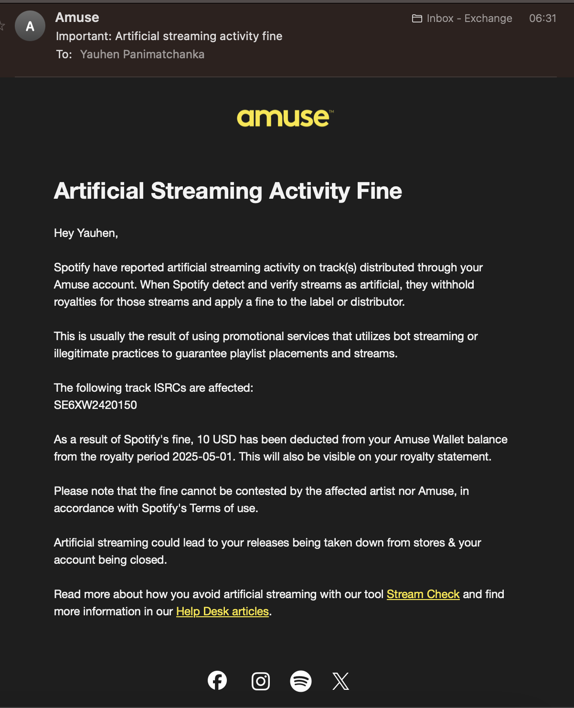
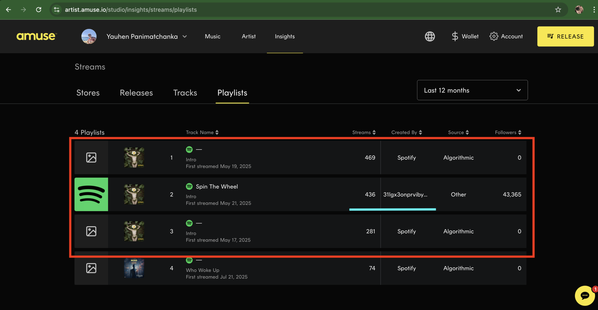
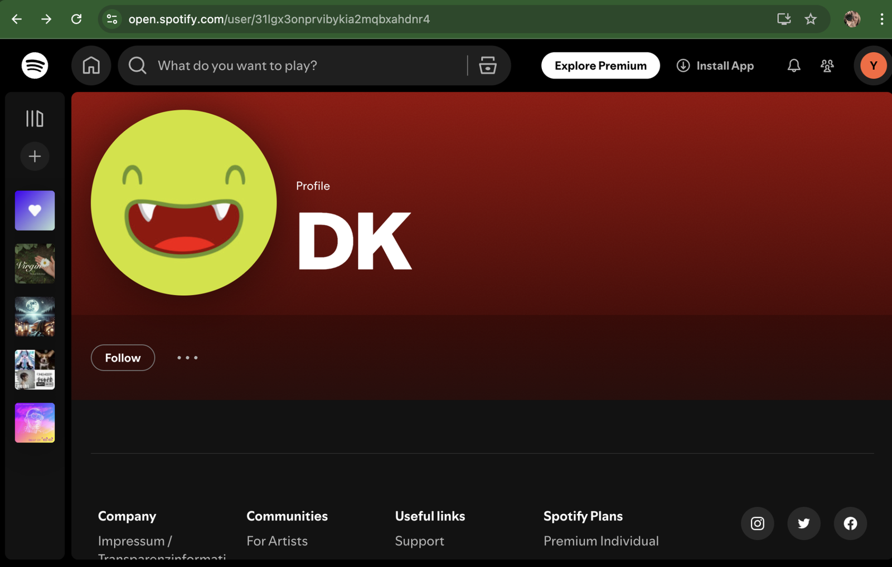
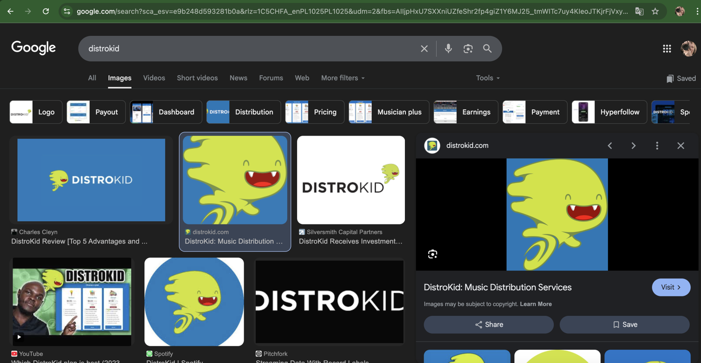
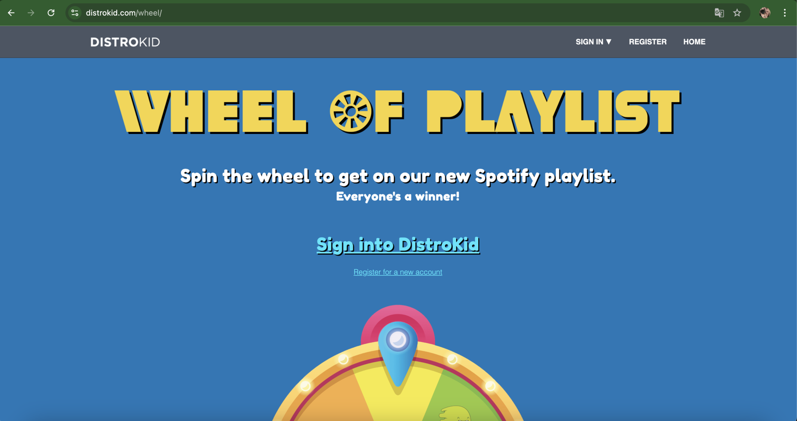

<pre class="note">⚠️ Disclaimer:
This article begins with personal experience and commentary. If you’re looking for hard facts, evidence, and platform behavior analysis — keep reading. All claims made in this article are followed by real screenshots, emails, and platform data.</pre>

For the second time, I have become a victim of Spotify’s unfair practices.

As an independent musician, releasing music on Spotify seems like an opportunity to reach listeners worldwide. But here’s the harsh truth:

- If you are not a globally popular artist, **your tracks will almost never reach the payout threshold.**
- Spotify’s internal rules mean that if a track does not generate enough unique streams, **your royalties are redistributed to bigger, more successful artists.**

Even worse, after about a year of using the platform, Spotify can suddenly accuse you of **artificial streaming**, fine you, and withhold your royalties.  
And when this happens, **Spotify does not allow any appeals or complaints.** Their answer is final: *“You are fined. Goodbye.”*

The result? **You don’t just fail to earn money for your music – you can actually end up owing money to Spotify.**

---

### The Dirty Game Between Distributors

What’s even more disturbing is how music distributors can abuse Spotify’s system.

Competitors can create **“dirty playlists”** and add tracks from artists signed with other distributors.  
Once these tracks get flagged as “artificial streams,” Spotify fines the distributor. This tactic pressures artists to leave their current distributor and move to the competitor.

I recently discovered that one of my tracks was added to a suspicious playlist owned by another distributor. The playlist was later removed for containing copyrighted music from other artists without permission.

This raises a serious concern: **Spotify’s lack of oversight allows distributors to sabotage each other while artists take the hit.**

---

### No Protection, No Appeals, No Fairness

Spotify presents itself as a platform that supports artists. In reality, **independent musicians often get nothing – not even the little they’ve earned.**

- No transparency about how royalties are distributed.
- No protection against sabotage or unfair penalties.
- No way to appeal when accused of artificial streaming.

Spotify has built a system where **big players win, distributors fight dirty, and small artists pay the price.**

---

Independent musicians deserve better. A platform that penalizes you unfairly, redistributes your royalties to bigger artists, and ignores clear cases of sabotage **does not support creativity – it exploits it.**

It’s time to question why we keep supporting a platform that actively works **against** the very artists it claims to empower.

Вот переработанная версия главы с акцентом не только на Amuse, а на общую проблему всех дистрибьюторов и Spotify:

---

## The Facts and the Investigation

Let’s move from opinions to facts.

Below is the email I received from **Amuse**, my distributor, informing me that Spotify fined me **\$10** for “artificial streaming” on my track **Intro (ISRC: SE6XW2420150)**:

<figure class="figure"></figure>

> *Spotify have reported artificial streaming activity on track(s) distributed through your Amuse account… As a result of Spotify’s fine, 10 USD has been deducted from your Amuse Wallet balance from the royalty period 2025-05-01…*

After receiving this email, I checked the playlist statistics for my track.  
Here is the reality:

<figure class="figure"></figure>

- My track appeared in **3 playlists** over the past year.
- **2 of these playlists were created by Spotify itself** (algorithmic playlists).
- **1 playlist**, called **“Spin The Wheel,”** was created **by DistroKid –** a direct **competitor of Amuse.**

<figure class="figure"><figcaption>The profile of a user who, without the rights holders’ consent, added tracks and played them illegally. Notice that Spotify did not completely remove this user from the platform, even though they were essentially engaging in unlawful activity. The only ones who suffered were the musicians.</figcaption></figure>

<figure class="figure"><figcaption>And in this screenshot, you can see official DistroKid brand images taken from a Google search and linking to the distributor’s official website. Doesn’t it seem that this green, fanged “character” looks quite similar to the one shown in the Spotify account profile that is engaged in illegal activity with music?</figcaption></figure>

<figure class="figure"><figcaption>The official page of the distributor DistroKid dedicated to this playlist, confirming the fact of its existence. As we can see, distributors do not even try to hide the existence of certain promotional playlists (even though Spotify officially opposes promotion in this way). At the same time, all of Spotify’s penalties fall on the shoulders of the artists, while the distributors’ contracts with Spotify remain unaffected.</figcaption></figure>

And here is the most absurd part:  
👉 The non-Spotify playlist generated **only around 400 streams in an entire year.**

**No legitimate promotional service would ever “buy streams” at such low numbers.**  
The monetization threshold on Spotify is **1,000 unique listeners**, meaning there is literally **no point in promoting a track at such a low level.**

---

### The Obvious Sabotage

What we are seeing here is **DistroKid illegally including other artists’ music in its playlists** and **provoking artificial streaming flags** to create problems for artists distributed via competitors.

This tactic pressures artists to leave their current distributor and switch to DistroKid.

---

### Why No Distributor Will Protect You

The sad truth is that **all distributors depend on their contracts with Spotify.**

- Spotify decides how royalties are paid and has the power to impose fines without providing any evidence.
- Distributors will never seriously challenge Spotify’s decisions for small artists, because **their business relationship with Spotify is more important than defending one beginner musician.**
- Complaints and appeals are considered **only for artists generating hundreds of thousands of dollars per month**. For everyone else, distributors simply pass Spotify’s decision on to the artist without question.

This creates a system where Spotify can **act with total impunity.**

The platform could theoretically introduce **random monthly fines for small artists**, and no one would protect them.

Distributors will not risk their contracts with Spotify to defend you – you are simply too small to matter in their business model.

Вот пример хорошо структурированного **постскриптума** для статьи:

---

### Postscript: The Unanswered Questions

Of course, some will say – perhaps even Spotify or DistroKid themselves – that all of this is just speculation, that they are innocent, and that this is merely a provocation against them.

But think about it:

- If someone is impersonating DistroKid on Spotify and using its name to commit illegal actions with music, **shouldn’t that be a reason for DistroKid to file a criminal complaint** for identity misuse? Shouldn’t they contact the police? Shouldn’t they at least inform Spotify that an account is committing fraud in their name – and that innocent musicians are being punished as a result?
- If Spotify notices suspicious activity tied to a playlist with over **43,000 followers**, isn’t that reason enough to **launch an internal investigation** into who is running such a playlist?

And yet, Spotify’s “solution” is simple: **remove the playlist (or more likely just hide it)** so that nobody can see it or investigate further.

According to Spotify’s own rules, the **maximum punishment for creating “bad” playlists is deleting the playlist or banning the account. That’s it.**  
Meanwhile, **all financial penalties are passed on to the innocent artists whose music was added without their consent.**

To make the playlist attractive, the offender likely mixes in popular tracks so that it appears in searches and recommendations. As a result, **innocent musicians suffer, and their already empty wallets take another hit.**

Spotify simply sends out a message saying **“We do not investigate artificial streaming or accept appeals.”**

---

And here’s the most cynical thought of all:  
**What if Spotify is actually interested in these playlists?**  
Think of how much money they can collect through fines – out of thin air – by creating a playlist, adding random artists to it, and then punishing them.

And due to Spotify’s policies, **even in a police investigation, an artist cannot force Spotify to reveal any information about the account behind the playlist.**

This is the system. And it’s designed so that **the only ones who always win are Spotify and its partners.**
