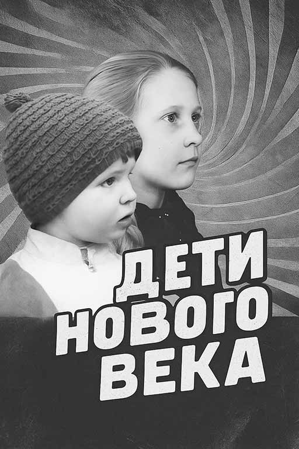

## The Idea Behind It

This album was not born out of a wish to sound “retro”, but out of simple human nostalgia.

I’m a child of the nineties, raised in Belarus — a place where television for many years still breathed with the rhythm of Soviet cinema. Those films played endlessly, and with them came the songs that are impossible to forget. Many of them stayed with me forever: *“Call Me, Call Me”*, *“We Are the Children of the Galaxy”*, *“The Beautiful Faraway”*… Their melodies still return unexpectedly, like voices from one’s own childhood.

But time moves on.

The songs of that era are fading, while the need for their sincerity remains.

So came the thought: what if I wrote my own songs — not imitations, not remakes — but music that **carries the same spirit**, that continues a conversation with the past without repeating its words.

## About the Songs

1. [**Call Me** *(russian: “Позвони мне”)*](/releases/songs/call-me/)  
   A song about the quiet between two people, about the moment when a connection is about to be lost — or rekindled. It draws on the mood of *Carnival Night* and *Magicians*, where waiting for a phone call turns into a small miracle.
2. [**We Are the Children of the Galaxy** *(russian: “Мы дети галактики”)*](/releases/songs/we-are-the-children-of-the-galaxy/)  
   Philosophical, almost cosmic in tone. It reflects on the passage of time: that fleeting moment between past and future in which we live, dream, stumble, and still move forward. It was inspired by the starry romanticism of Soviet film music — from *“Don’t Think About Seconds from Above”* to *“The Beautiful Faraway”*.
3. [**While the Fire Still Plays in Our Eyes** *(russian: “Пока в глазах огонь играет”)*](/releases/songs/while-the-fire-still-plays-in-our-eyes/)  
   The most playful and spirited track on the record. Here, the echoes of *“Song of the Sword”* and *“We Are Just Children”* from *The Adventures of Elektronik* intertwine. It’s a manifesto of sorts: **to live is to act, to laugh, to believe**, and never to sheathe one’s sword while there’s still fire in one’s eyes.

## The Cover

<figure class="figure"></figure>

The cover shows a real black-and-white photograph — two childhoods: my mother’s and my own.

At first glance it looks simple, but it explains everything. The title *“Children of the New Century”* *(russian: “Дети нового века”)* can be read in more than one way.

Every century is “new” at the moment it arrives, and the twentieth was once new too — a century of faith and hope.

So, the “children of that century” are us: those who grew up with its music, its films, its dreams.

That’s why the cover shows no symbols — only **real people**.

Memory made visible.

## Where to Listen

The album *Children of the New Century* is available on all streaming platforms:

- [Apple Music](https://music.apple.com/pl/album/%D0%B4%D0%B5%D1%82%D0%B8-%D0%BD%D0%BE%D0%B2%D0%BE%D0%B3%D0%BE-%D0%B2%D0%B5%D0%BA%D0%B0-single/1849938883)
- [YouTube Music](https://music.youtube.com/playlist?list=OLAK5uy_kQ5_MyAS4pazoi42XD-twmOS652Grvyv0&si=cVSX_fppyy2uYt1W)
- [Amazon Music](https://www.amazon.com/music/player/albums/B0FYQTKF5S)

## Afterword

This album isn’t about the past or the future. It’s about people who **remember what childhood sounded like**. And if even one of these songs reminds you of your own — then it has done its job.
