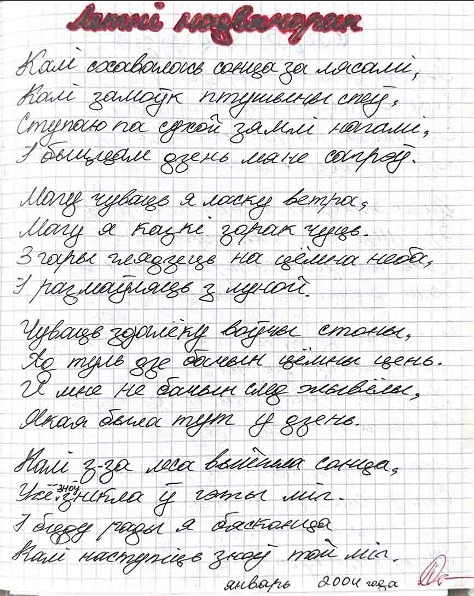

### Evoking Belarusian Beauty in Song

In the vibrant tapestry of contemporary Belarusian music, the new single “Летні надвячорак” (“Summer Dusk”) stands out as a melodious homage to the country’s scenic landscapes and the ethereal beauty of its evenings. Crafted by an emerging artist, the single channels the lyrical genius of Yauhen Panimatchanka, whose poetry, penned during his school days back in 2004, serves as the backbone for this song.

Yauhen, though academically inclined towards mathematics and analytics, showed little interest in subjects like Russian and Belarusian language or literature during his schooling. Nonetheless, thanks to the nurturing influence of his mother, Alena Panimatchanka (Asuleva), Yauhen honed a remarkable ability to craft verses effortlessly. This talent did not go unnoticed by his language teachers, who, appreciating his poetic flair, often cooperated to balance his modest academic performances in their subjects with high grades for his poetic contributions.

<figure class="figure"></figure>

“Летні надвячорак” (“Summer Dusk”) is not only a celebration of Belarusian natural beauty but also a sonic journey back in time. The song is deliberately styled to resonate with the iconic sounds of “Pesnyary” (“Песняры”), a legendary Belarusian ensemble known for their folk tunes that have shaped the nation’s musical heritage. Through this song, the artist aspires to transport listeners back to the nostalgic era of Pesnyary’s music or even to the year 2004—a simpler time when the lyrics were originally written and when Yauhen was just a child, discovering his poetic voice.

This nostalgic musical journey through “Летні надвячорак” (“Summer Dusk”) thus serves as a bridge connecting modern Belarusian music with its rich historical roots, celebrating the timeless beauty of the Belarusian landscape through the universal language of song. The single not only showcases Yauhen’s poetic versatility but also underscores a deep cultural reverence for Belarus’ pastoral charms and its historical musical narratives.

### Lyrics

<pre class="lyrics">Калі схавалась сонца за лясамі,
Калі замоўк птушыны спеў,
Ступаю па сухой зямлі нагамі,
І быццам дзень мяне сагрэу.

Магу чуваць я ласку ветра,
Магу я казкі зорак чуць.
З гары глядзець на цёмна неба,
І размауляць з луной.

Чуваць здалёку воучы стоны,
Ад туль дзе бачын цёмны цень.
І мне не бачын след жывелы,
Якая была тут у дзень.

Магу чуваць я ласку ветра,
Магу я казкі зорак чуць.
З гары глядзець на цёмна неба,
І размауляць з луной.

Калі з-за леса выйшла сонца,
Усё зноу знікла ў гэты міг.
І буду рады я бясконца
Калі наступіць зноў той міг.</pre>

## Where to listen “Summer Dusk”?

- [Apple Music](https://music.apple.com/pl/album/%D0%BB%D0%B5%D1%82%D0%BD%D1%96-%D0%BD%D0%B0%D0%B4%D0%B2%D1%8F%D1%87%D0%BE%D1%80%D0%B0%D0%BA/1797176282?i=1797176283)
- [Amazon Music](https://music.amazon.com/tracks/B0DXMZZY64?marketplaceId=A3K6Y4MI8GDYMT&musicTerritory=PL&ref=dm_sh_2kzCqFx7r6tXtBDUYlHSj4O3j)
- [Youtube Music](https://music.youtube.com/watch?v=cxd9nhEy_mY&si=UcAmunstOa7kXYqR)
